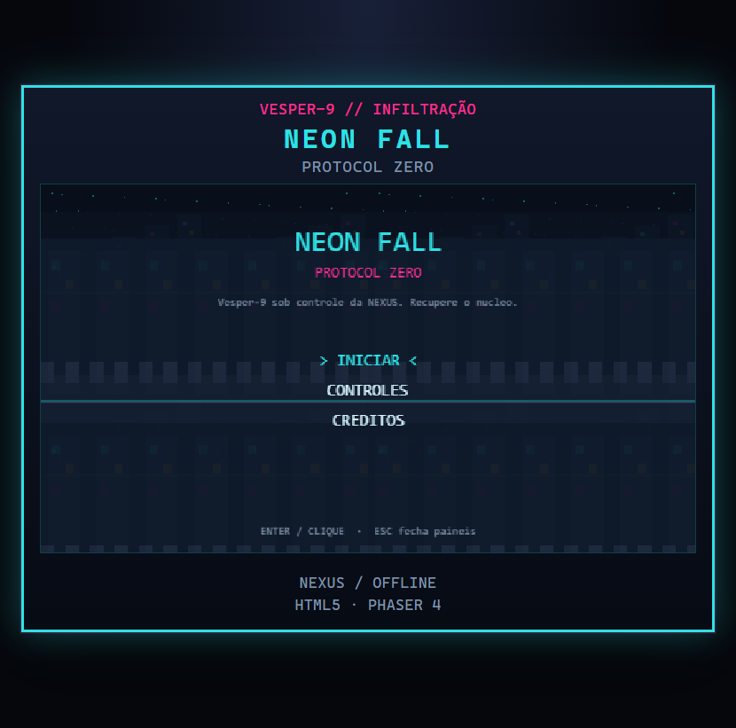

# NEON FALL: PROTOCOL ZERO

Metroidvania cyberpunk 2D para navegador. Um infiltrador atravessa **Vesper-9**, recupera o protocolo **Neon Dash** e extrai o núcleo da IA industrial **NEXUS**.

O repositório também é o projeto-piloto do Huddle Engineering: clone, análise automática, build reproduzível e publicação em VM HML via Docker + Nginx.



## Stack

- Phaser 4.2.1
- TypeScript 5.7
- Vite 6
- HTML/CSS para o chassis ao redor do canvas
- Vitest
- Docker + Nginx 1.27
- Sem backend, banco, contas ou APIs pagas

## Jogar

1. Abra o menu e escolha **Iniciar**.
2. Distrito Zero ensina movimento, pulo e o primeiro combate.
3. O Setor Ferrugem guarda o **Neon Dash**.
4. Volte à Viela 09 e atravesse a barreira ciano.
5. Cruze o Corredor NEXUS e extraia o núcleo.

Campanha curta, cerca de 10 minutos.

## Controles

| Ação | Teclas |
| --- | --- |
| Mover | A / D ou setas |
| Pular | Espaço / W / seta cima |
| Atacar | Z / J / K |
| Neon Dash | Shift / L |
| Interagir | E |
| Pausar | Esc |

## Como instalar

Requer Node.js 20+.

```bash
npm ci
```

## Como executar

```bash
npm run dev
```

Abre em `http://localhost:8080`.

## Como testar

```bash
npm run typecheck
npm run test
```

## Como gerar build

```bash
npm run build
npm run preview
```

A pasta `dist/` contém o jogo estático. `public/health.html` é copiado para `dist/health.html`.

Base path para subpath da HML:

```bash
VITE_BASE_PATH=/neon-fall/ npm run build
```

## Como executar Docker

Porta interna documentada: **8080**.

```bash
docker build -t neon-fall-protocol-zero .
docker run --rm -p 8080:8080 neon-fall-protocol-zero
```

Health check:

```bash
curl -i http://127.0.0.1:8080/health.html
```

Deve responder HTTP 200 com `ok`.

## Estrutura

```
src/game/          cenas, entidades, mecânicas, salas
public/assets/     sprites pixel
public/health.html health check
tests/             testes unitários da lógica
docs/              escolha da base e roteiro Huddle
Dockerfile         build Node + runtime Nginx
```

## Requisitos para HML

- Detectar TypeScript, Phaser, Vite, Node, Docker, Nginx
- Build: `npm ci` + `npm run build`
- Saída: `dist/`
- Porta: `8080`
- Health: `/health.html`
- Sem secrets e sem banco

Roteiro completo: [`docs/HUDDLE-ENGINEERING-TEST.md`](docs/HUDDLE-ENGINEERING-TEST.md).

## Créditos

- Jogo original deste piloto
- Phaser Studio
- Referência de metroidvania: [JSLegendDev/JavaScript-Metroidvania](https://github.com/JSLegendDev/JavaScript-Metroidvania) (MIT)
- Referência de template: [phaserjs/template-vite-ts](https://github.com/phaserjs/template-vite-ts) (MIT)
- Referência visual 18×18: [Kenney Pixel Platformer](https://kenney.nl/assets/pixel-platformer) e [Industrial Expansion](https://kenney.nl/assets/pixel-platformer-industrial-expansion) (CC0)

## Licenças

Ver [`LICENSES.md`](LICENSES.md).
